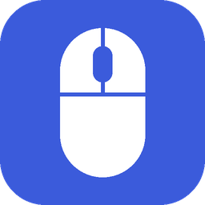
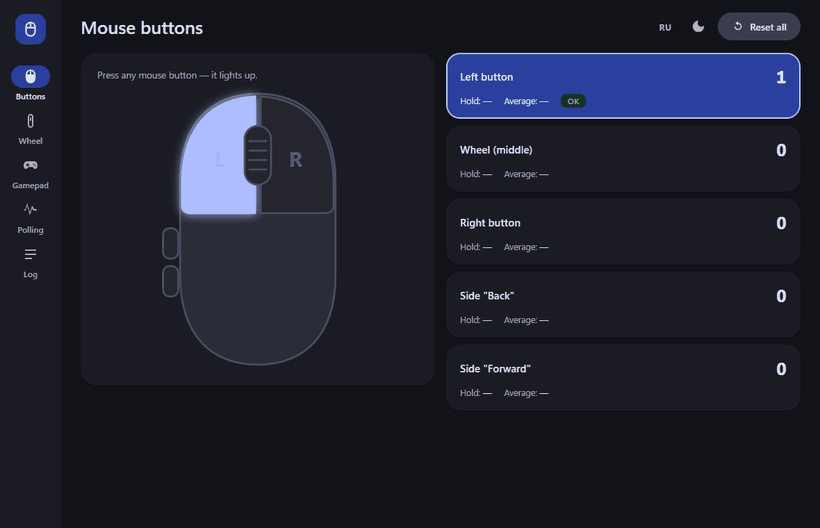
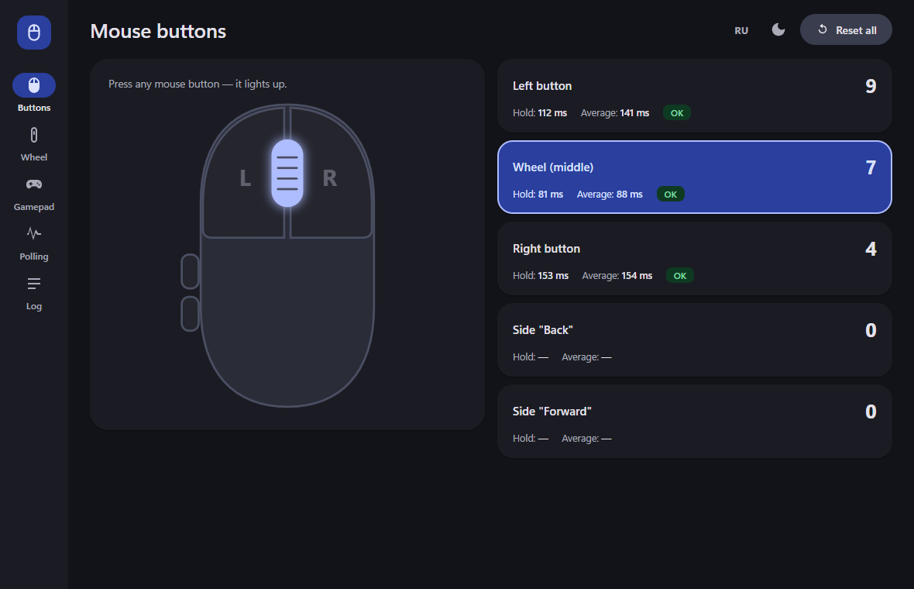
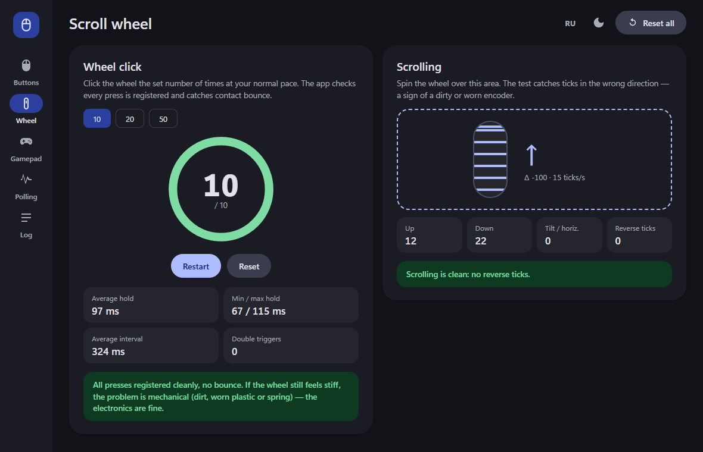
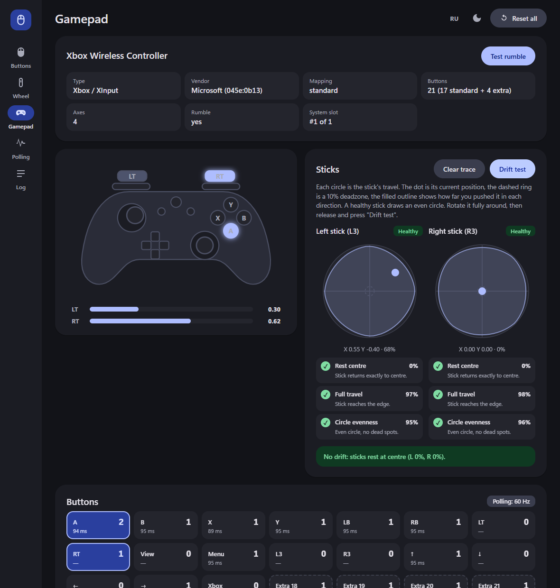
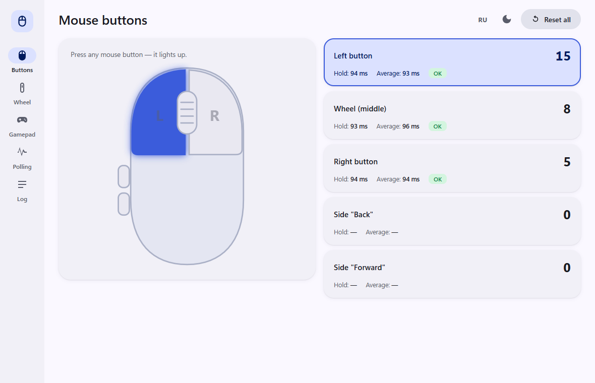

<div align="center">



<h1>Mouse Tester</h1>

<p>
  <a href="README.md"></a>
  <a href="README.ru.md"></a>
</p>

<p>
  <a href="https://github.com/BadHuko/mouse-tester/releases/latest"></a>
  <a href="https://github.com/BadHuko/mouse-tester/releases"></a>
  
  
  <a href="LICENSE"></a>
</p>

<p>
  <a href="https://github.com/BadHuko/mouse-tester/releases/latest/download/MouseTester.exe"></a>
</p>

<br>



</div>

<br>

Portable mouse and gamepad tester for Windows with a Material 3 UI. No installer, no admin rights, nothing written to disk: download one `.exe`, run it, delete it when you're done.

Built because a mouse wheel got hard to click but still scrolled fine — is it the switch, the encoder or just dirt? Now there's a way to tell.

## What it tests

| | |
|---|---|
| **Mouse buttons** | All 5 buttons (left, wheel, right, back, forward): press counter, hold time, **contact bounce** (re-press < 50 ms) |
| **Wheel click** | Click the wheel 10 / 20 / 50 times: is every press registered? Average/min/max hold, double triggers, plain-language verdict |
| **Scrolling** | Ticks up/down, horizontal tilt, **reverse ticks** — the classic sign of a dirty or worn encoder |
| **Gamepad** | Xbox / PlayStation / Nintendo / generic: type + vendor detection, every button incl. extra paddles and touchpad, analog triggers, both sticks with a travel outline, **stick drift test**, per-stick health checks, rumble, polling rate |
| **Polling rate** | Real mouse polling rate in Hz with a live graph |
| **Event log** | Every event with millisecond timestamps |

Light / dark theme and English / Russian switch live in the top bar.

## Screenshots

<table>
  <tr>
    <td></td>
    <td></td>
  </tr>
  <tr>
    <td></td>
    <td></td>
  </tr>
</table>

## My wheel is stiff but scrolls fine

Open **Wheel → Wheel click** and press the wheel 10–20 times.

- All presses counted, no double triggers → the electronics are fine; the stiffness is mechanical (dust, worn plastic, spring).
- **Double triggers** reported → the wheel microswitch is worn or dirty and sometimes counts one click as two. Clean it or replace the switch.
- **Reverse ticks** while scrolling → the encoder is dirty or worn.

## Download

Grab `MouseTester.exe` from the [latest release](https://github.com/BadHuko/mouse-tester/releases/latest) and run it. Requires Windows 10/11 (uses the built-in Edge WebView2).

Windows SmartScreen may warn about an unknown publisher because the exe isn't code-signed — choose *More info → Run anyway*, or build it yourself (below).

## Build from source

Python 3.10+:

```bat
git clone https://github.com/BadHuko/mouse-tester
cd mouse-tester
build.bat
```

The result is `dist\MouseTester.exe` (single file, ~17 MB). To run without building: `pip install -r requirements.txt && python main.py`.

README screenshots and the demo GIF are generated by `tools/make_screens.py` (real mouse input, simulated gamepad).

## Stack

Python + [pywebview](https://pywebview.flowrl.com/) for the window, a hand-made Material 3 UI in plain HTML/CSS/JS (no external dependencies, works offline), PyInstaller for the portable exe, GitHub Actions for releases.

## License

[MIT](LICENSE)
