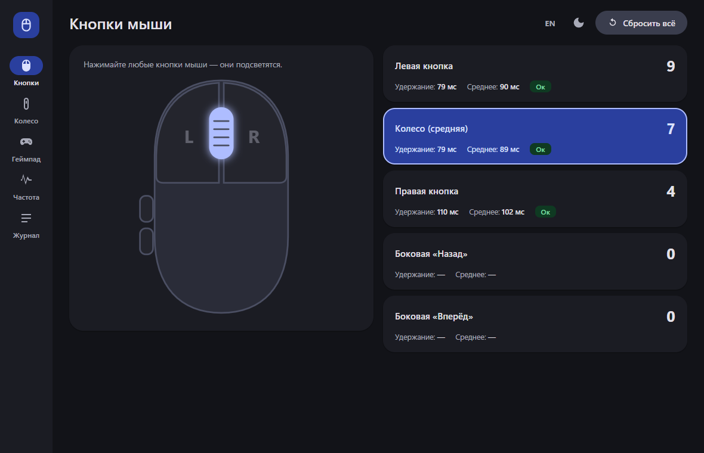
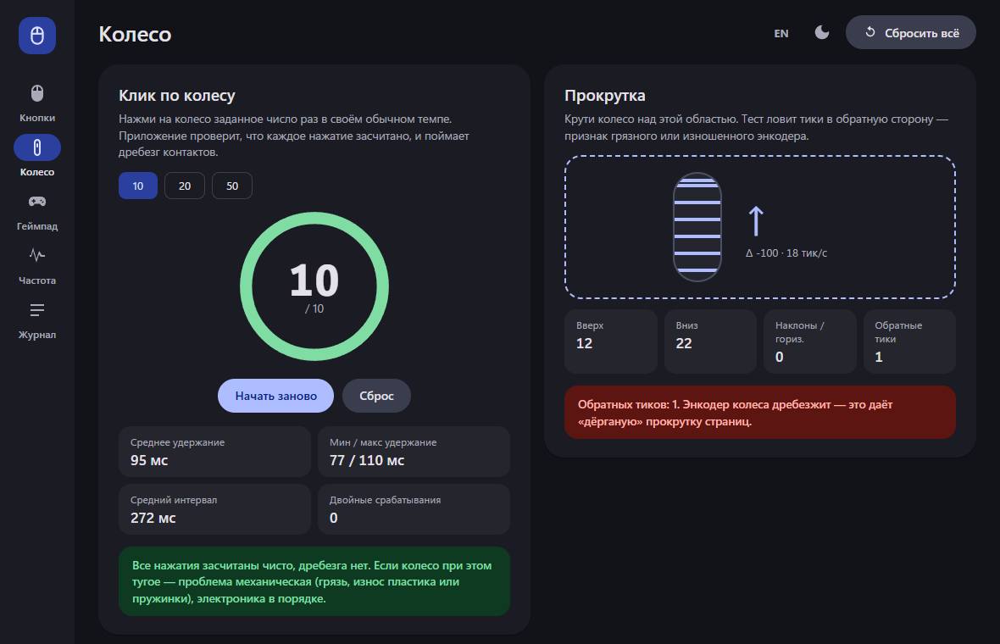
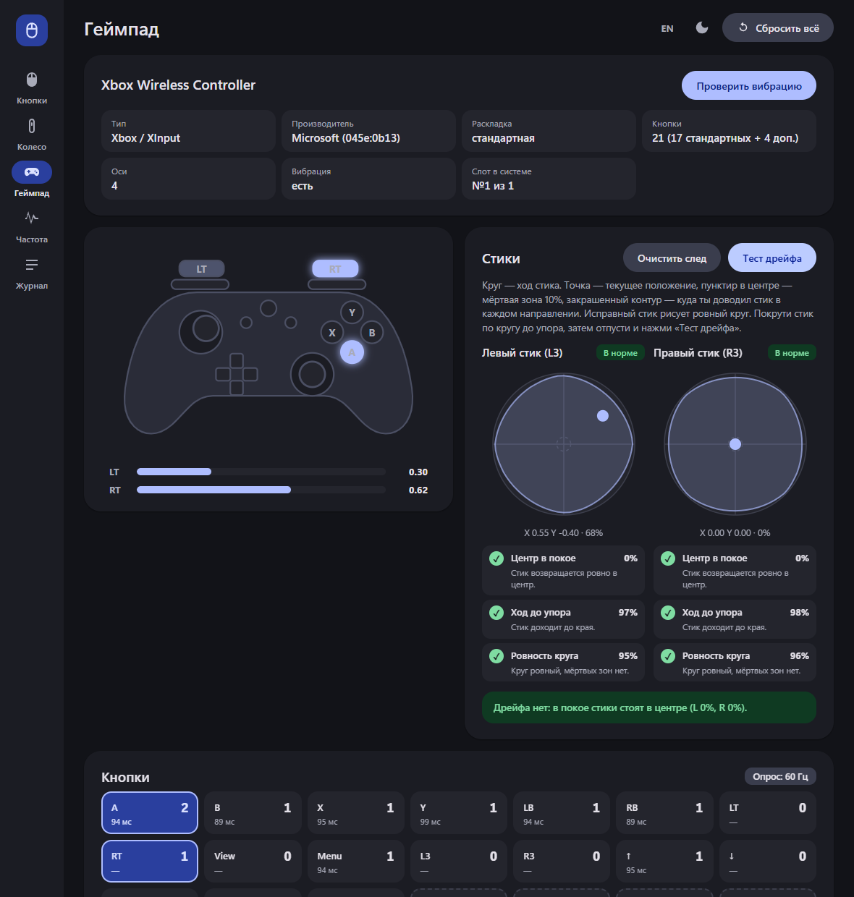

<div align="center">


<h1>Mouse Tester</h1>

<p>
  <a href="README.md"></a>
  <a href="README.ru.md"></a>
</p>

<p>
  <a href="https://github.com/BadHuko/mouse-tester/releases/latest"></a>
  <a href="https://github.com/BadHuko/mouse-tester/releases"></a>
  
  
  <a href="LICENSE"></a>
</p>

<p>
  <a href="https://github.com/BadHuko/mouse-tester/releases/latest/download/MouseTester.exe"></a>
</p>

<br>


</div>

<br>

Портативный тестер мыши и геймпада для Windows с интерфейсом Material 3. Без установщика, без прав администратора и без записи на диск: скачал один `.exe`, запустил, проверил, удалил.

Сделано потому, что колесо мыши стало туго нажиматься, но при этом нормально крутится — что там: микрик, энкодер или просто грязь? Теперь это можно проверить.

## Что проверяет

| | |
|---|---|
| **Кнопки мыши** | Все 5 кнопок (левая, колесо, правая, назад, вперёд): счётчик нажатий, время удержания, **дребезг контактов** (повторное нажатие быстрее 50 мс) |
| **Клик по колесу** | Нажми колесо 10 / 20 / 50 раз: засчитано ли каждое нажатие? Среднее/мин/макс удержание, двойные срабатывания, вердикт простым языком |
| **Прокрутка** | Тики вверх/вниз, горизонтальный наклон, **тики в обратную сторону** — классический признак грязного или изношенного энкодера |
| **Геймпад** | Xbox / PlayStation / Nintendo / универсальный: определение типа и производителя, все кнопки (включая доп. и тачпад), аналоговые триггеры, оба стика с контуром хода, **тест дрейфа**, проверки состояния каждого стика, вибрация, частота опроса |
| **Частота опроса** | Реальная частота опроса мыши в Гц с живым графиком |
| **Журнал** | Все события с миллисекундными метками |

Светлая/тёмная тема и переключатель русский/английский — в верхней панели.

## Скриншоты

<table>
  <tr>
    <td></td>
    <td></td>
  </tr>
  <tr>
    <td></td>
    <td></td>
  </tr>
</table>

## Колесо тугое, но нормально крутится

Открой **Колесо → Клик по колесу** и нажми колесо 10–20 раз.

- Все нажатия засчитаны, двойных срабатываний нет → электроника в порядке, туго из-за механики (пыль, износ пластика, пружинка).
- Есть **двойные срабатывания** → микропереключатель колеса изношен или грязный, один клик иногда считается за два. Прочисти или замени микрик.
- Есть **обратные тики** при прокрутке → энкодер грязный или изношен.

## Скачать

Бери `MouseTester.exe` из [последнего релиза](https://github.com/BadHuko/mouse-tester/releases/latest) и запускай. Нужна Windows 10/11 (используется встроенный Edge WebView2).

Windows SmartScreen может предупредить о неизвестном издателе, так как exe не подписан: нажми *Подробнее → Выполнить в любом случае* или собери сам (ниже).

## Сборка из исходников

Python 3.10+:

```bat
git clone https://github.com/BadHuko/mouse-tester
cd mouse-tester
build.bat
```

Результат: `dist\MouseTester.exe` (один файл, ~17 МБ). Запуск без сборки: `pip install -r requirements.txt && python main.py`.

Скриншоты и demo.gif в README генерирует `tools/make_screens.py` (настоящий ввод мышью, геймпад симулируется).

## Стек

Python + [pywebview](https://pywebview.flowrl.com/) для окна, собственный Material 3 UI на чистом HTML/CSS/JS (без внешних зависимостей, работает офлайн), PyInstaller для portable-exe, GitHub Actions для релизов.

## Лицензия

[MIT](LICENSE)
